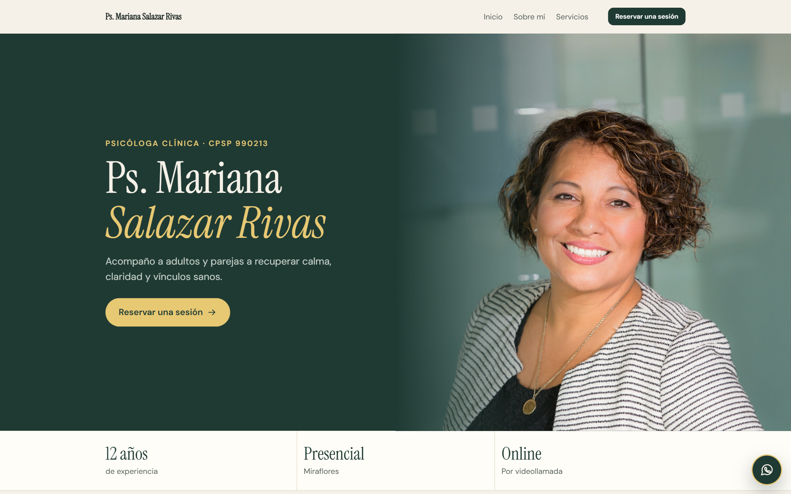
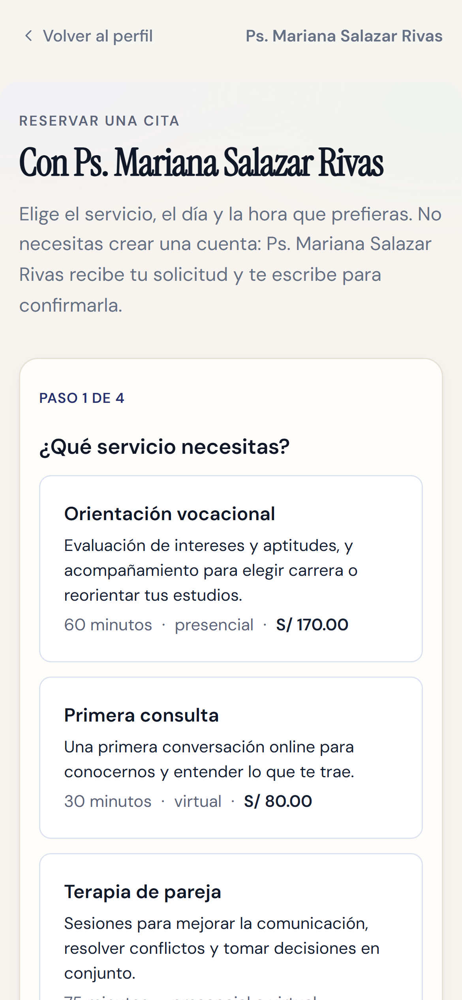
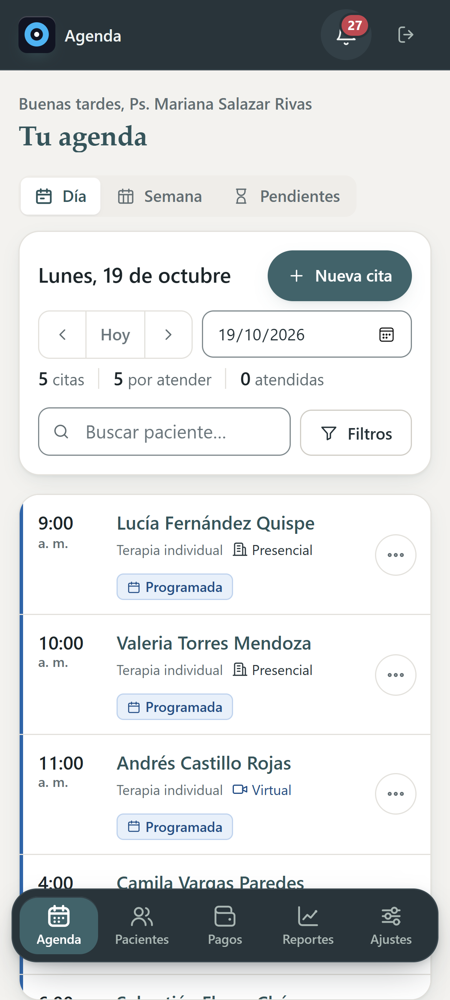
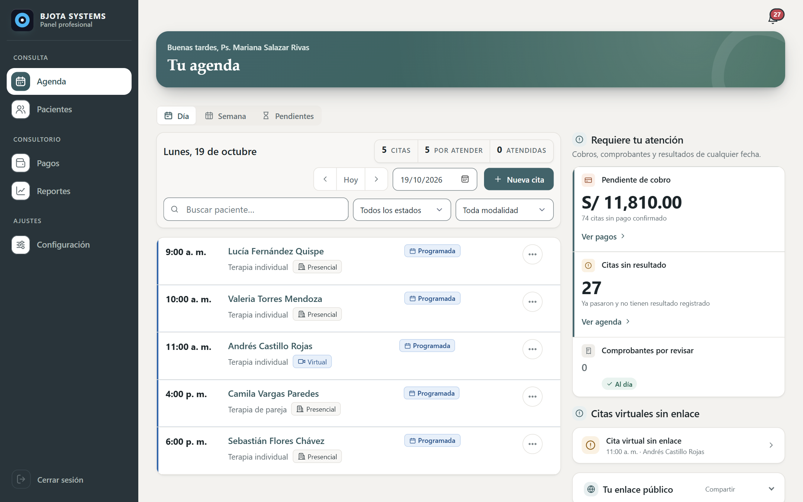
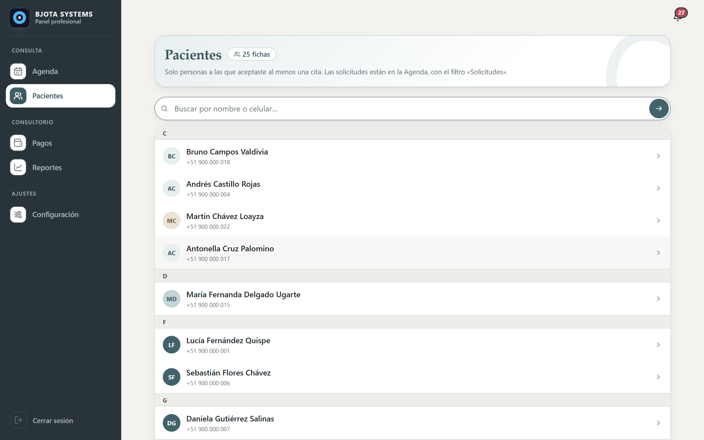
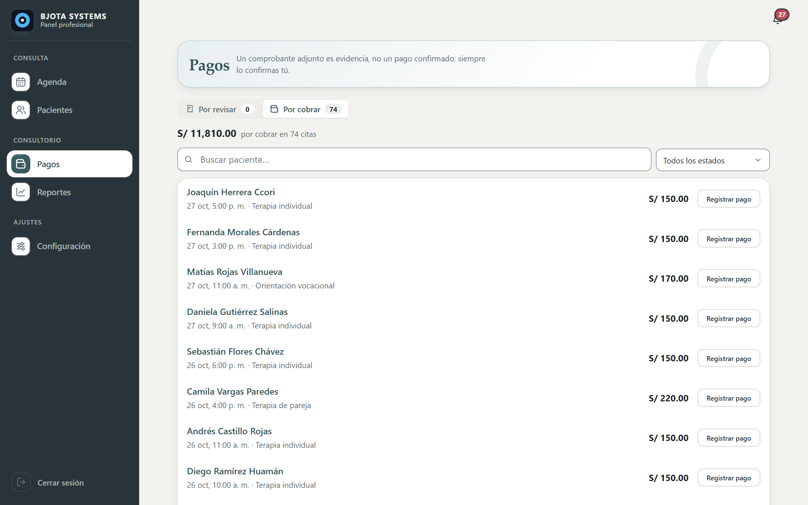
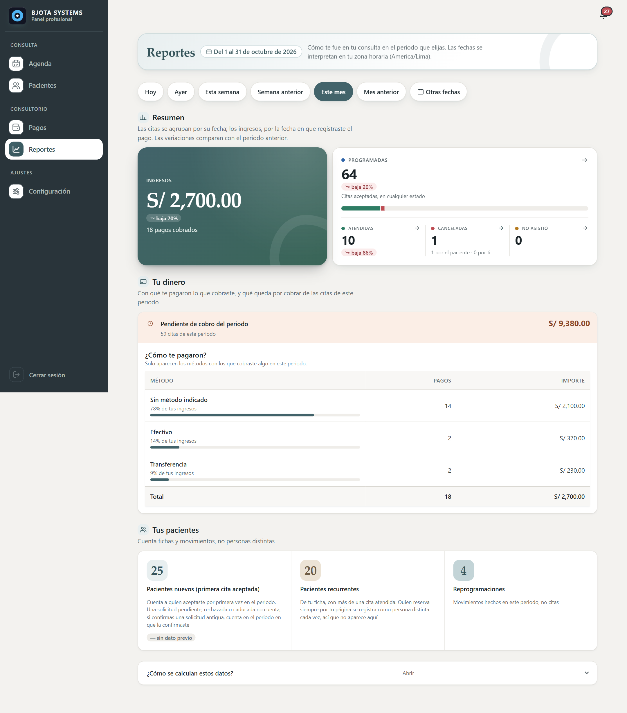
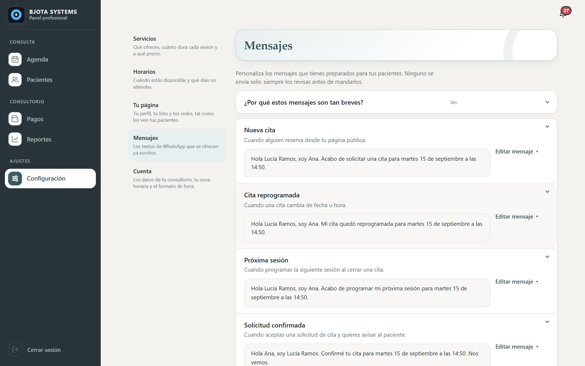
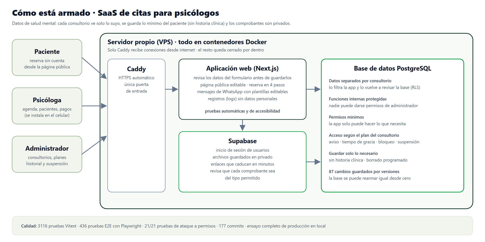

# SaaS de citas para psicólogos independientes

**Agenda, pacientes, cobros y reportes con privacidad para datos de salud mental · 2026**

En este SaaS multi-consultorio:
- Cada psicóloga tiene una **página pública editable**.
- Sus pacientes **reservan sin crear cuenta**.
- Ella gestiona agenda, pacientes, pagos con comprobante, mensajes de WhatsApp y reportes desde el celular.

📄 **[Caso de estudio completo (PDF)](docs/caso-de-estudio.pdf)**

---

## El problema

Las psicólogas independientes gestionan su consulta con WhatsApp, cuadernos y memoria:
- Las citas y reprogramaciones se conversan por chat.
- Los comprobantes de pago llegan sueltos.
- No hay un registro claro de quién debe qué.
- Los datos de los pacientes quedan sin ninguna protección.

## La solución

| Para | Qué hace |
|---|---|
| **El paciente** | Página de la profesional (enfoque, temas, servicios, formación, ubicación, preguntas frecuentes) y reserva en 4 pasos **sin cuenta** |
| **La psicóloga** | Confirma o rechaza solicitudes y ve su agenda del día y de la semana. También: «programar siguiente cita», «pasar a virtual» y reprogramación con enlace de un solo uso para el paciente |
| **Los cobros** | Efectivo o comprobante, con aprobación o rechazo; pendientes de cobro y comprobantes por revisar |
| **La comunicación** | Mensajes de WhatsApp listos (`wa.me`) con plantillas editables, enviados desde su propio número |
| **Los números** | Reportes por periodo: ingresos, atendidas, inasistencias y cobros por método |
| **La plataforma** | Super Admin con consultorios, planes, auditoría y suspensión de acceso, aplicados por la base de datos |

## Capturas

| Perfil en el celular | Reservar sin cuenta | Agenda en el celular |
|---|---|---|
|  |  |  |

| Pacientes | Pagos |
|---|---|
|  |  |
| **Reportes** | **Plantillas de WhatsApp** |
|  |  |

## Arquitectura

**Decisiones clave:**
- **Aislamiento en dos capas:** la aplicación y PostgreSQL con RLS, más 8 claves foráneas compuestas con `organization_id`. Se verificó con 17 pruebas contra una base real.
- **Minimización:** no se guardan historia clínica, notas ni diagnósticos; solo lo necesario para agendar y cobrar.
- **Archivos privados:** los comprobantes se validan por su firma binaria (SVG prohibido) y se sirven con URLs firmadas de 5 a 10 minutos.
- **Supabase autoalojado** en Docker Compose detrás de Caddy, el único servicio que expone puertos.

## Seguridad: un fallo real encontrado y corregido

Durante las pruebas adversariales descubrí un problema:
- **El fallo:** una función `SECURITY DEFINER` sin `pg_temp` en su `search_path` permitía **saltarse RLS y escalar a Super Admin**.
- **La corrección:** se arregló y ahora una prueba de regresión falla si cualquier función queda sin esa protección.

Además:
- Privilegios recortados (`TRUNCATE`, `TRIGGER`, `REFERENCES`, `MAINTAIN`) y **21/21 pruebas adversariales**; rol `app_user` y PostgREST cerrado.
- Logs con datos personales y secretos redactados (33 pruebas).
- Medición real del límite de autenticación, documentada como riesgo a reforzar.
- Modelo de amenazas basado en OWASP, clasificación de datos, retención programada y pruebas de accesibilidad con axe-core.

## Calidad

- **3116 pruebas Vitest** (unitarias e integración) en el último registro.
- **436 pruebas E2E con Playwright** en 58 specs, que recorren los flujos reales de la psicóloga y del paciente.
- **87 migraciones** versionadas y **177 commits**.

## Estado

- ✅ **MVP completo y probado** en un **ensayo de producción en local**: los mismos contenedores que irán al VPS, con HTTPS, backups y restauración.
- ⏳ **Siguiente paso:**
  - despliegue en el VPS, dominio y certificados reales;
  - correo transaccional;
  - la política de backups antes de recibir datos reales.
- 🚫 **Fuera del MVP a propósito:** pasarela de pago, recordatorios automáticos y autogestión del paciente.

## Mi rol

Proyecto propio de principio a fin:
- Definí el producto con una psicóloga piloto.
- Diseñé el modelo de datos, la arquitectura y la estrategia de privacidad.
- Desarrollé la aplicación con apoyo de asistentes de IA.
- Escribí las pruebas: unitarias, de integración, adversariales y E2E.
- Preparé la infraestructura autoalojada.

---

> 🔒 **Repositorio vitrina:** no se publican el código fuente, los datos reales ni los secretos de infraestructura.
>
> Las capturas son de una copia local con la cuenta de demostración «Ps. Mariana Salazar Rivas». La persona, los pacientes y los teléfonos son ficticios; la foto es de Unsplash (Christina @ wocintechchat).

**Bryan Jeremy Espinoza Herrera** · BJOTA Systems · Perú
